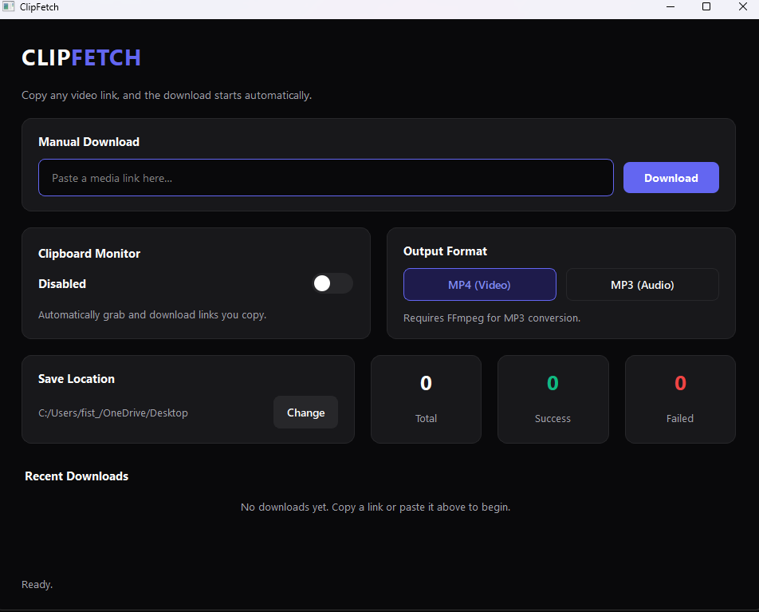

<div align="center">

&#x20; <h1>ClipFetch</h1>

&#x20; <p><b>A sleek, auto-fetching media downloader built with PySide6 and yt-dlp.</b></p>

</div>


<p align="center"></p>


\## Overview

ClipFetch is a modern, lightweight desktop application designed to eliminate the friction of downloading media. With its built-in clipboard monitor, it automatically detects copied video links and processes them in the background. Wrapped in a clean, minimalist interface, it offers seamless transitions between video (MP4) and audio (MP3) downloads without relying on bloated browser extensions.


\## Core Features

\- \*\*Clipboard Monitoring:\*\* Toggle the monitor to instantly queue and download links as soon as you copy them.

\- \*\*Format Flexibility:\*\* Download high-quality MP4 videos or extract audio to MP3 on the fly.

\- \*\*Real-Time Analytics:\*\* Track active download speeds, exact progress percentages, and total success/failure statistics.

\- \*\*Clean UI/UX:\*\* A responsive, smooth GUI built with PySide6, featuring a tailored dark theme.

\- \*\*Standalone Capability:\*\* Includes batch scripts for instant execution or one-click compilation into a single `.exe` file.


\## Prerequisites

To run ClipFetch from the source or build it, you ensure you have the following:

\- \*\*Python 3.8+\*\*

\- \*\*FFmpeg\*\* \*(Required specifically for MP3 audio extraction. Ensure it is added to your system's PATH).\*


\## Installation \& Usage


\### Option A: Quick Start (Windows)

Simply run the included batch file to automatically install dependencies and launch the app instantly:

```cmd

start.bat

